  

I work in endpoint and systems support, and I am building deeper hands-on networking skills through routing, switching, packet analysis, segmentation, and network-security projects.

My production experience includes Windows endpoint troubleshooting, Microsoft 365 and identity support, Cisco Meraki investigation, DHCP and DNS troubleshooting, cabling and Ethernet pass-through loops, Verifone M400 payment-terminal connectivity, endpoint lifecycle coordination, PuTTY and SSH account support, knowledge-base writing, more than 2,000 documented tickets, and new-hire training.

I use GitHub to document what I built, how I tested it, and what the results showed.

The projects below are some of the work I have chosen to feature. To view all of my public repositories, visit [my repositories page](https://github.com/hypnatiq?tab=repositories).

## Networking and Support Projects

### [Hypnatiq Network Observatory](https://github.com/hypnatiq/hypnatiq-network-observatory)

HypNO is my Windows endpoint and network-investigation project. It connects live TCP and UDP activity and imported packet captures to process, service, executable, publisher, signature, destination, and provider context when that evidence is available.

During each investigation, I keep confirmed local activity separate from third-party reports. The user reviews the findings and chooses Allow or Block. HypNO can then write a reversible rule to Windows Defender Firewall with Advanced Security and record the change.

### [Enterprise Home Network Virtual Lab](https://github.com/hypnatiq/enterprise-home-network-virtual-lab)

My Enterprise Home Network Virtual Lab is a working virtual version of the network I plan to implement in my home. I use it to practice Windows Server identity, DNS, Group Policy, Windows LAPS, OPNsense segmentation, FreeRADIUS EAP-TLS decisions, client isolation, and PXE service testing while I continue acquiring the physical hardware.

The first physical build plan uses a TP-Link ER605 V2 router, SG2008P managed PoE switch, OC300 controller, and EAP610 wireless access point. Those devices remain planned and unpurchased while I verify the household connection, hardware revisions, firmware compatibility, cabling, port capacity, and recovery plan. I document the architecture, failed tests, corrections, screenshots, hashes, and accepted results so the virtual lab can guide the later installation.

### [AstrasGZ Network Traffic Analysis Case Study](https://github.com/hypnatiq/network-traffic-analysis-case-study)

I created this case study to understand what traffic left my Windows PC while I used the AstrasGZ client. I captured and reviewed three controlled sessions, imported 120,656 packet records into a local Flask and SQLite viewer, and filtered the evidence by protocol, port, destination, and time.

The case study records what the capture showed, what it could not confirm, and what I would test next.

### [IT Support Documentation Portfolio](https://github.com/hypnatiq/it-support-documentation-portfolio)

I built this portfolio to show how I troubleshoot and document support work so another technician can continue without starting over. It includes sanitized runbooks, a service-desk process standard, and an anonymized network-connectivity case study built around the same method I use: confirm what is affected, record a baseline, change one condition, validate the original issue, and escalate with useful evidence.

## How I use AI

I use AI to speed up research, documentation, testing, and project work while keeping validation and final decisions in my hands.

I do not treat generated output as proof. I keep requirements, privacy limits, evidence review, failed-result review, and approval decisions under my control.

## Other public work

- [AI-Assisted Technical Project Workflow](https://github.com/hypnatiq/ai-assisted-technical-project-workflow) documents the evidence and approval process I use across projects.
- [HypBot Discord Server Builder](https://github.com/hypnatiq/hypbot-discord-server-builder) explains how I stage, verify, and recover Discord server changes while keeping live credentials, IDs, member data, and private source out of the public repository.
- [Hypnatiq DPI Calibrator](https://github.com/hypnatiq/hypnatiq-dpi-calibrator) documents my Windows calibration method, Raw Input checks, settings recovery, repeated testing, and the limits of a personal recommendation.
- [Project Handoff Verification Toolkit](https://github.com/hypnatiq/project-handoff-verification-toolkit) contains the PowerShell scripts I use to create SHA-256 manifests, verify transferred folders, and compare returned project trees.
- [Rapid Trigger for GunZ](https://github.com/hypnatiq/rapid-trigger-for-gunz) is a community guide and personal testing notebook. It records starting settings, controlled changes, test results, and rollback points. It remains on GitHub but is not part of my current resume or LinkedIn project lineup.

## Current direction

I am continuing to build practical depth in routing, switching, TCP/IP, DHCP, DNS, firewall policy, packet analysis, network access control, and network troubleshooting. I will add certifications when they are earned, not before.

I use these projects to build on my support experience and continue developing practical network engineering skills.
